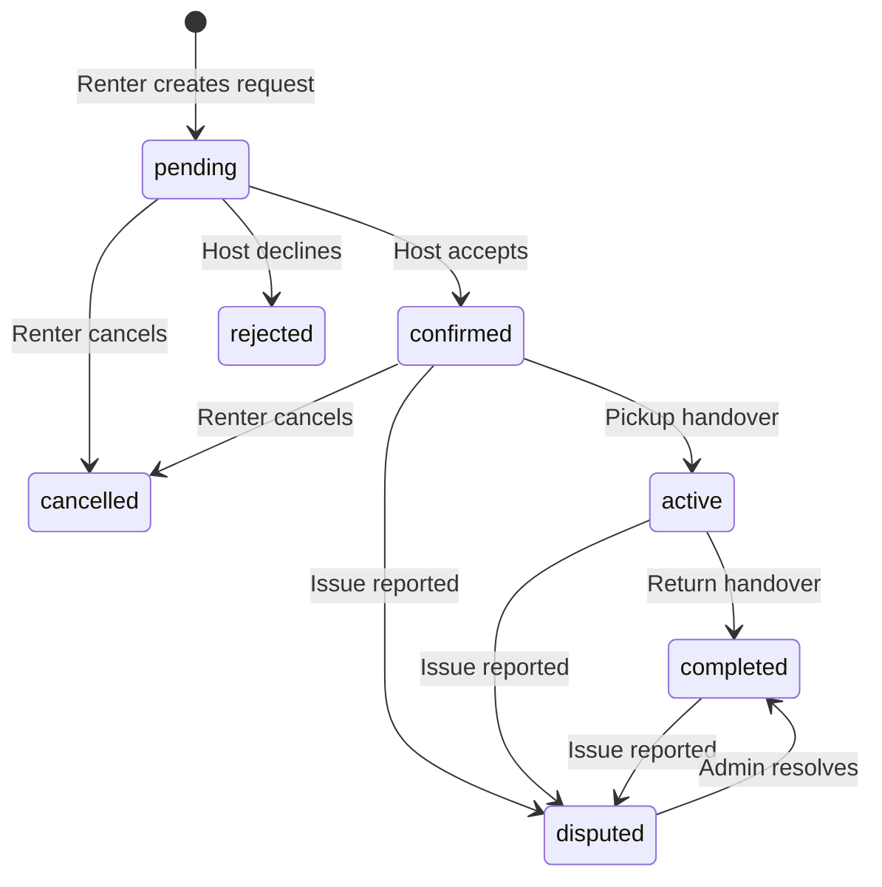

# RentPeer Nigeria

RentPeer is a peer-to-peer car rental MVP for Nigeria. It connects renters with vehicle hosts and uses an intermediary agency workflow for driver verification, vehicle verification, booking oversight, simulated escrow records, and dispute handling.

The application is a Node.js and Express API with MongoDB persistence and a browser-based vanilla JavaScript frontend.

## Contents

- [MVP scope](#mvp-scope)
- [Requirements](#requirements)
- [Installation and startup](#installation-and-startup)
- [Demo accounts](#demo-accounts)
- [How the application works](#how-the-application-works)
- [User roles](#user-roles)
- [Booking lifecycle](#booking-lifecycle)
- [Pricing and simulated escrow](#pricing-and-simulated-escrow)
- [API reference](#api-reference)
- [Project structure](#project-structure)
- [Testing](#testing)
- [Configuration](#configuration)
- [Important MVP limitations](#important-mvp-limitations)
- [Production checklist](#production-checklist)

## MVP Scope

The current MVP includes:

- Renter and host registration and login
- JWT-based sessions
- Public vehicle browsing, searching, filtering, sorting, and detail pages
- Host vehicle listing, activation, pausing, and deletion
- Admin KYC and vehicle verification queues
- Date availability checks against active bookings and blocked vehicle dates
- Booking requests and host approval or rejection
- Pickup and return handover records
- Simulated escrow, refund, host payout, and agency commission transaction records
- Renter cancellation
- Dispute submission and admin resolution
- Verified renter reviews and vehicle/host ratings
- Admin metrics, bookings, and transaction views
- Automated API workflow tests

Real payment gateway integration, messaging, SMS, email, maps, and mobile applications are outside the MVP.

## Requirements

- Node.js 18 or newer
- npm
- MongoDB, or a working internet connection for the automatic in-memory MongoDB fallback used by development and tests

A local MongoDB server is optional. If `MONGODB_URI` is unavailable or the configured database cannot be reached, the app starts `mongodb-memory-server` automatically.

## Installation and Startup

From the project root:

```powershell
npm install
npm start
```

Open the application at:

```text
http://localhost:5000
```

The development command uses Node's watch mode:

```powershell
npm run dev
```

The API health endpoint is:

```text
http://localhost:5000/api/health
```

Expected response:

```json
{
  "status": "online",
  "service": "RentPeer P2P Car Rental Platform API"
}
```

### Startup behavior

1. The server loads environment variables from `.env`.
2. It connects to `MONGODB_URI` or starts an in-memory MongoDB fallback.
3. It seeds demo data only when the database has no users.
4. It starts the Express server on `PORT` or port `5000`.
5. It serves both the API and the frontend from the same process.

Existing data is not deleted during startup. The seed routine skips seeding when users already exist.

## Demo Accounts

The development seed creates these accounts:

| Role | Email | Password |
| --- | --- | --- |
| Agency admin | `admin@rentpeer.com` | `admin123` |
| Host | `host@rentpeer.com` | `host123` |
| Second host | `elena@rentpeer.com` | `host123` |
| Verified renter | `renter@rentpeer.com` | `renter123` |
| Pending-KYC renter | `sam@rentpeer.com` | `renter123` |

These credentials are for local development only. Change or remove them before any public deployment.

## How the Application Works

### 1. Explore fleet

Guests can browse approved and active vehicles without logging in. The explore page supports:

- City
- Start and end dates
- Category
- Make/model keyword search
- Transmission
- Fuel type
- Maximum daily rate
- Sort order

When dates are supplied, vehicles with overlapping pending, confirmed, or active bookings are excluded. Vehicle blocked dates are also excluded.

### 2. Register or log in

A user can register as a renter or host. Login returns a JWT token, which the frontend stores in browser local storage and sends as:

```text
Authorization: Bearer <token>
```

The admin role is never available through public registration. Only an existing admin can use the admin role.

### 3. Complete KYC

A renter or host submits a driver license number, ID type, and optional document image. The account becomes `pending` until an admin approves or rejects the submission.

A renter must have `kycStatus: verified` before creating a booking. A host must have verified KYC before creating a vehicle listing.

### 4. Host lists a vehicle

A verified host submits vehicle information, location, pricing, documents, features, and images. New listings begin as:

```text
verificationStatus: pending
```

The vehicle is not shown in the public catalog until an admin approves it.

### 5. Renter requests a booking

A verified renter selects a vehicle and dates. The API validates:

- Required vehicle and dates
- Valid date values
- Start date is not in the past
- End date is after start date
- Vehicle is approved and active
- Renter is not booking their own vehicle
- No overlapping reservation exists

The booking starts as `pending` and creates simulated escrow transaction records.

### 6. Host accepts or declines

The vehicle host sees incoming requests in the Host Operations Center.

- Accepting changes the booking to `confirmed`.
- Declining changes it to `rejected` and records a refund transaction.
- A renter can cancel a `pending` or `confirmed` booking, changing it to `cancelled` and recording a refund transaction.

The API rechecks date conflicts during acceptance so two requests cannot both be accepted for the same vehicle and dates.

### 7. Pickup and return

A confirmed booking can be started with pickup odometer, fuel level, and notes:

```text
confirmed -> active
```

An active booking can be completed with return odometer, fuel level, and notes:

```text
active -> completed
```

Completion creates a simulated host payout and security-deposit refund, increments trip counters, and releases the booking payment status.

### 8. Review and dispute

After completion, the renter can submit one verified review for the booking. The vehicle and host ratings are recalculated.

For a confirmed, active, or completed trip, a participant can report an issue. An admin can inspect the booking and resolve the dispute with a refund, host payout, or dismissal action.

## User Roles

### Renter

A renter can:

- Browse and search approved vehicles
- Submit KYC
- Request bookings after KYC approval
- View trips and receipts
- Cancel pending or confirmed bookings
- Start a confirmed trip
- Complete an active trip
- Submit a review after completion
- Report a booking issue

### Host

A host can:

- Submit KYC
- Create and manage vehicle listings after KYC approval
- Pause or activate listings
- View incoming booking requests
- Accept or decline requests
- Confirm returns and release simulated payout
- View fleet and earnings metrics

### Agency admin

An admin can:

- View platform metrics
- Review and approve or reject KYC submissions
- Review and approve or reject vehicle listings
- View all bookings
- Resolve disputes
- View transaction records

All admin API routes require both a valid JWT and the `admin` role.

## Booking Lifecycle



The stored booking statuses are:

- `pending`: waiting for host decision
- `confirmed`: host accepted the request
- `active`: vehicle pickup was recorded
- `completed`: vehicle return was recorded
- `cancelled`: renter cancelled
- `rejected`: host declined

Payment statuses are:

- `pending`
- `escrow_held`
- `released_to_host`
- `refunded`

## Pricing and Simulated Escrow

All displayed and stored amounts are Nigerian naira (`NGN`). The booking total is calculated on the server:

```text
subtotal = dailyRate * totalDays
serviceFee = round(subtotal * 0.15)
insuranceFee = 5000 * totalDays
securityDeposit = vehicle.securityDeposit

totalAmount = subtotal + serviceFee + insuranceFee + securityDeposit
```

The MVP does not charge a real card or bank account. Creating a booking creates a completed `booking_payment` transaction to represent a successful escrow hold.

When a booking is cancelled, a `refund` transaction is recorded. When a trip is completed, the system records:

- A `host_payout` transaction equal to the booking subtotal
- A `refund` transaction equal to the security deposit

These records are simulation data and are not proof of a real financial transfer.

## API Reference

All protected endpoints require a Bearer token.

### Authentication

| Method | Endpoint | Access | Purpose |
| --- | --- | --- |
| `POST` | `/api/auth/register` | Public | Create renter or host account |
| `POST` | `/api/auth/login` | Public | Authenticate and receive JWT |
| `GET` | `/api/auth/me` | Authenticated | Get current user |
| `PUT` | `/api/auth/profile` | Authenticated | Update name, phone, bio, or avatar |
| `POST` | `/api/auth/kyc` | Authenticated | Submit KYC data and document image |
| `POST` | `/api/auth/switch-role` | Authenticated | Switch between renter and host demo portals |

The admin role cannot be obtained through registration or role switching by a non-admin.

### Vehicles

| Method | Endpoint | Access | Purpose |
| --- | --- | --- |
| `GET` | `/api/cars` | Public | Browse approved active vehicles |
| `GET` | `/api/cars/:id` | Public | Get approved vehicle details and reviews |
| `GET` | `/api/cars/my-fleet` | Host/admin | Get owned fleet |
| `POST` | `/api/cars` | Verified host/admin | Create listing; supports up to six uploaded images |
| `PUT` | `/api/cars/:id` | Owner/admin | Update listing |
| `DELETE` | `/api/cars/:id` | Owner/admin | Delete listing |
| `PATCH` | `/api/cars/:id/toggle-active` | Owner/admin | Pause or activate listing |

Useful catalog query parameters include `city`, `category`, `minPrice`, `maxPrice`, `transmission`, `fuelType`, `seats`, `sort`, `startDate`, `endDate`, and `search`.

### Bookings

| Method | Endpoint | Access | Purpose |
| --- | --- | --- |
| `POST` | `/api/bookings` | Verified renter | Create booking request |
| `GET` | `/api/bookings/my-trips` | Renter | Get renter bookings |
| `GET` | `/api/bookings/host-reservations` | Host/admin | Get host reservations |
| `PATCH` | `/api/bookings/:id/accept` | Host/admin | Accept pending booking |
| `PATCH` | `/api/bookings/:id/decline` | Renter/host/admin | Cancel or decline booking |
| `PATCH` | `/api/bookings/:id/start-trip` | Participant/admin | Record pickup and start trip |
| `PATCH` | `/api/bookings/:id/complete-trip` | Participant/admin | Record return and complete trip |
| `POST` | `/api/bookings/:id/dispute` | Participant/admin | Open a booking issue |

### Reviews

| Method | Endpoint | Access | Purpose |
| --- | --- | --- |
| `GET` | `/api/reviews/car/:carId` | Public | Read vehicle reviews |
| `POST` | `/api/reviews` | Authenticated renter | Review a completed booking |

### Admin

| Method | Endpoint | Access | Purpose |
| --- | --- | --- |
| `GET` | `/api/admin/metrics` | Admin | Platform and financial metrics |
| `GET` | `/api/admin/kyc-queue` | Admin | List KYC records |
| `PATCH` | `/api/admin/kyc/:userId` | Admin | Approve or reject KYC |
| `GET` | `/api/admin/cars-queue` | Admin | List vehicle verification records |
| `PATCH` | `/api/admin/cars/:carId/verify` | Admin | Approve or reject vehicle |
| `GET` | `/api/admin/bookings` | Admin | List all bookings |
| `PATCH` | `/api/admin/bookings/:id/resolve-dispute` | Admin | Resolve dispute |
| `GET` | `/api/admin/transactions` | Admin | List financial records |

## Project Structure

```text
public/
  index.html              Single-page application markup and modals
  css/                    Global, component, and dashboard styles
  js/
    app.js                View routing and application orchestration
    api.js                Fetch client, auth headers, and NGN formatting
    auth.js               Login, registration, KYC, and session handling
    cars.js               Fleet search, details, pricing, and booking UI
    bookings.js           Renter trips, handover, reviews, disputes, receipts
    host.js               Host fleet and reservation management
    admin.js              Admin queues, metrics, and dispute operations
    state.js               Shared client-side state
    notifications.js      Toast notification system
  uploads/                Uploaded development documents and images

server/
  server.js               Express app, database bootstrap, static hosting
  config/db.js            MongoDB and in-memory fallback connection
  middleware/auth.js      JWT authentication and role authorization
  middleware/upload.js    Multer upload configuration
  controllers/            Business logic for each domain
  routes/                 HTTP route definitions
  models/                 Mongoose schemas
  seed/seedData.js        Development users, vehicles, bookings, and reviews

tests/
  api_test.js             End-to-end API workflow and authorization tests
```

## Testing

Start the server in one terminal:

```powershell
npm start
```

Run the tests in a second terminal:

```powershell
npm test
```

The test suite verifies:

- Health endpoint
- Admin, host, and renter login
- Prevention of renter-to-admin escalation
- Public vehicle catalog and filters
- Prevention of renter vehicle creation
- Missing-booking handling
- Booking creation and pricing
- Pending-booking transition protection
- Host acceptance
- Pickup and return transitions
- Simulated payout and deposit refund
- Verified review submission
- Admin metrics and moderation queues

The tests use future dates and select an available vehicle so repeated runs do not intentionally collide with an earlier test booking.

## Configuration

Create a `.env` file in the project root. It should not be committed.

```env
PORT=5000
MONGODB_URI=mongodb://127.0.0.1:27017/p2p_car_rental
JWT_SECRET=replace-with-a-long-random-secret
NODE_ENV=development
```

If `MONGODB_URI` is omitted or unavailable, the development fallback uses an in-memory database. That data disappears when the process stops.

## Important MVP Limitations

- Payments are simulated transaction records, not real payments.
- Escrow is a database status, not a regulated custody service.
- No email, SMS, or persistent notification system exists.
- No renter-host messaging exists.
- KYC is an agency review queue, not an external identity verification integration.
- Uploaded document storage is local filesystem storage.
- There is no password reset or email verification flow.
- The seed accounts and passwords are development credentials.
- The API does not provide production-grade rate limiting, audit logging, or monitoring.
- The frontend uses local storage for JWT sessions.

## Production Checklist

Before deploying publicly:

1. Replace all demo passwords and use a strong `JWT_SECRET`.
2. Configure a managed MongoDB database.
3. Disable automatic demo seeding in production or replace it with a controlled migration process.
4. Integrate a real NGN payment provider and verify webhook signatures.
5. Store uploads in managed object storage with access controls.
6. Add rate limiting, security headers, request validation, and audit logging.
7. Add email verification, password reset, and account recovery.
8. Add real notification delivery for booking and KYC events.
9. Review legal, insurance, KYC, escrow, and data-retention requirements for Nigeria.
10. Run negative-path, concurrency, upload-security, and payment-failure tests before launch.
